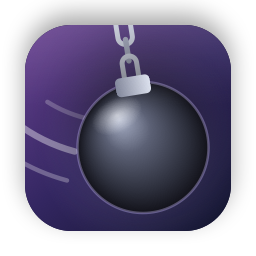

# Wreckingball

A screen recorder for quick demos on macOS.

OBS is great, but it's built for streaming. Wreckingball does one job: record a single window, framed over a nice background, with your camera in a corner, straight to an `.mp4` file. Keep it on a second screen and switch which window you're presenting with a click, a shortcut or a Stream Deck button, without stopping the recording. The same framed canvas can go into a window you share live in a call.



## Features

- **Fixed output size:** 720p, 1080p, 1440p or 4K at 30 or 60 fps, saved as H.264 or HEVC `.mp4`.
- **Pause and resume** mid-recording, without a gap or a drift in the finished file.
- **Live window switching:** a window picker down the side, grouped by app, with up to nine pinned windows. It only lists windows that can actually be captured.
- **Backgrounds:** gradient presets (including soft "aurora" styles), your own gradient colours, a flat colour, or an image (including your desktop picture) with blur and dim. Optional vignette and film grain.
- **Framing:** padding, rounded corners and a shadow around the presented window.
- **Camera overlay:** circle, squircle, rounded square, wide or hexagon. Drag it around the preview to place it, and show or hide it separately for recording and for presenting.
- **Keystroke overlay:** shows the shortcuts you press, or everything you type, in a pill you can style and drag into place. Password fields are never shown.
- **Presentation window:** mirror the canvas into a bare window you can share in Google Meet, Zoom or Slack.
- **Microphone audio**, with an input picker and level meter.
- **Remote control:** configurable global shortcuts and a `wreckingball://` URL scheme, both usable from a Stream Deck.

Requires macOS 15 or later.

## Download

Get the latest `Wreckingball-<version>.zip` from [Releases](https://github.com/danielcooper/wreckingball/releases), unzip it and move **Wreckingball.app** to Applications.

### Opening it the first time

Builds aren't signed with an Apple Developer ID or notarised, so macOS blocks the first launch:

1. Open Wreckingball. macOS says it can't verify the developer; click **Done**.
2. Open **System Settings → Privacy & Security**, scroll down, and click **Open Anyway** next to the message about Wreckingball.
3. Confirm with your password. After that it opens normally.

Alternatively, in Terminal:

```bash
xattr -dr com.apple.quarantine /Applications/Wreckingball.app
```

### Permissions

On first use macOS asks for:

- **Screen & System Audio Recording**, to capture windows. Quit and reopen Wreckingball after allowing it.
- **Camera** and **Microphone**, for the overlay and audio.
- **Input Monitoring**, only if you turn on the keystroke overlay.

Because the builds aren't signed with a fixed identity, macOS may ask for Screen Recording access again after you update. If that happens, remove the old Wreckingball entry in System Settings and allow the new one.

## Using it

- **Choose a window** from the list on the right. Hover over a window and click the pin to give it a numbered slot.
- **Background**, **Framing**, **Camera** and **Keys** in the bottom bar each open a settings panel over the window list. The preview stays uncovered, so you can drag the camera and the keystroke sample while you adjust them.
- **Camera** has separate switches for recording and presenting. Presenting starts with the camera off, since in a call your camera usually has a tile of its own.
- **Record** starts and stops recording. Recordings are saved to `~/Movies/Wreckingball` unless you change it in Settings.
- **Pause**, next to the timer while recording, stops writing without closing the file; press it again to carry on. The timer counts only what's in the file, and the border around the preview turns amber so a glance at a second screen tells you it's paused. The preview and the window you're presenting carry on as normal while paused.
- **Present** opens a window showing the same framed canvas, for sharing live in a call. Pick **Wreckingball Presentation** from the call's window list. The window has no visible title bar or controls, so only the canvas is shared; its close and resize buttons appear when you move the pointer over it. Drag it anywhere, send it full screen, or leave it on a second display. Wreckingball records or presents, not both, so Record is unavailable while the window is open.

### Shortcuts and Stream Deck

No shortcuts are set by default. Set them in **Settings → Shortcuts** for recording, pausing, next and previous window, pinned windows 1–9, the camera and the keystroke overlay. A Stream Deck **Hotkey** action can then press them.

URL commands also work. Use `open -g` so the app you're presenting keeps focus:

| URL | Action |
|---|---|
| `wreckingball://record/toggle` | Start or stop recording |
| `wreckingball://record/start` | Start recording |
| `wreckingball://record/stop` | Stop recording |
| `wreckingball://pause/toggle` | Pause or resume recording |
| `wreckingball://record/pause` | Pause recording |
| `wreckingball://record/resume` | Resume recording |
| `wreckingball://pin/<n>` | Present pinned window `n` (1–9) |
| `wreckingball://window/next` | Present the next window |
| `wreckingball://window/previous` | Present the previous window |
| `wreckingball://camera/toggle` | Show or hide the camera |
| `wreckingball://keys/toggle` | Show or hide keystrokes |

## Building from source

The project uses [XcodeGen](https://github.com/yonaskolb/XcodeGen) to generate the Xcode project from `project.yml`.

```bash
# Install XcodeGen if you don't have it
brew install xcodegen

# Generate the Xcode project
xcodegen generate

# Open in Xcode
open Wreckingball.xcodeproj
```

Then build and run from Xcode. To sign with your own team, change `DEVELOPMENT_TEAM` in `project.yml`.

The app icon is drawn in code. To change it, edit `Tools/MakeIcon.swift`, then regenerate the PNGs:

```bash
swiftc -O Tools/MakeIcon.swift -o /tmp/makeicon && /tmp/makeicon Wreckingball/Media.xcassets/AppIcon.appiconset
```

### Releases

Every push to `main` is built by GitHub Actions and the app is attached to the workflow run. Pushing a version tag builds it and publishes a GitHub release:

```bash
git tag v0.1.0
git push origin v0.1.0
```

## Licence

Copyright © 2026 Daniel Cooper.

Wreckingball is free software: you can redistribute it and/or modify it under the terms of the GNU General Public License as published by the Free Software Foundation, either version 3 of the License, or (at your option) any later version. See [LICENSE](LICENSE).

Wreckingball uses [KeyboardShortcuts](https://github.com/sindresorhus/KeyboardShortcuts) by Sindre Sorhus, under the MIT License.
